<h1 align="center">📚 Ed Tech</h1>

<p align="center">
  <b>One unified Flutter mobile application connecting learners with top programs and instructors with powerful management tools.</b>
</p>

<p align="center">
  
  
  
  
  
</p>

<p align="center">
  <a href="https://www.figma.com/design/QWMnhOtY99AqOI90lf4yMk/Team-6-Wireframes?node-id=0-1&t=R7Ajb2Jlw7v95zlR-1"><b>🎨 View Wireframes on Figma</b></a>
</p>

---

## 📖 About the Project
**Ed Tech** is a cross-platform mobile application developed with Flutter and Dart for the **Excelerate Mobile App Development Remote Internship (Cohort 0510)** by **Team 6**. 

The app bridges the gap between students seeking structured learning programs and teachers managing their courses, enrolled learners, and revenue.

---

## 📱 App in Action — UI Showcase (All Screenshots)

### 🎓 1. Learner Journey: Onboarding & Home Portal

| Role Selection | Learner Login | Learner Signup | Learner Home Portal |
|:---:|:---:|:---:|:---:|
| 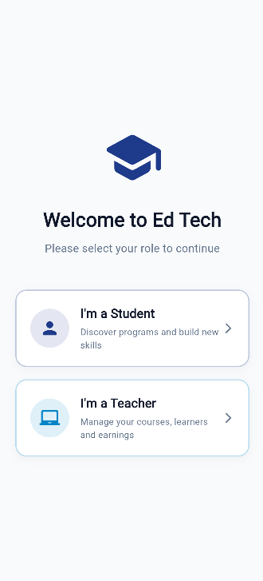 | 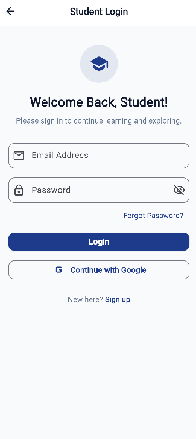 | 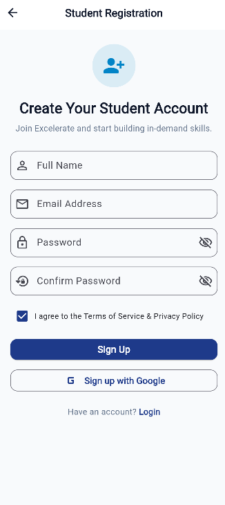 | 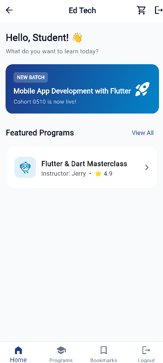 |
| *Role selector (Student vs Teacher)* | *Email & password validation* | *Registration with terms check* | *Progress tracking & announcements* |

---

### 📚 2. Program Discovery, Course Details & Checkout

| Programs List | Program Details | My Cart | Checkout & Payment |
|:---:|:---:|:---:|:---:|
| 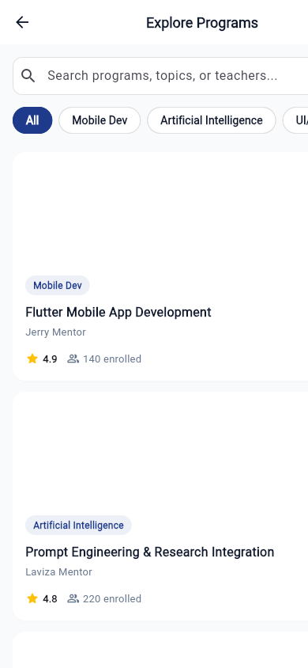 | 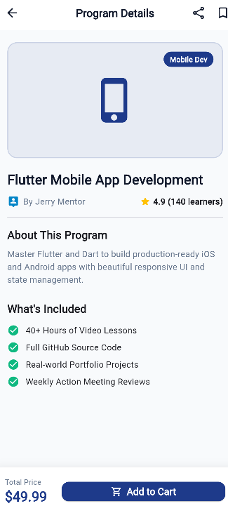 | 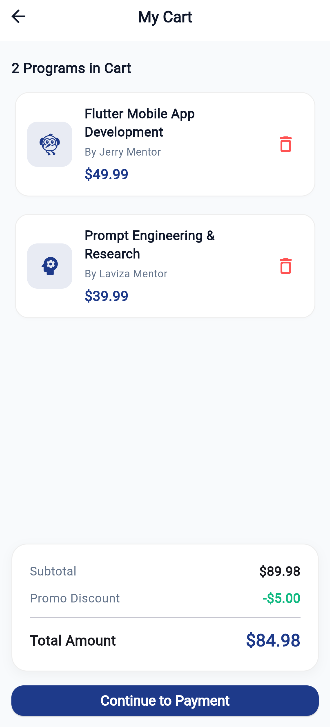 | 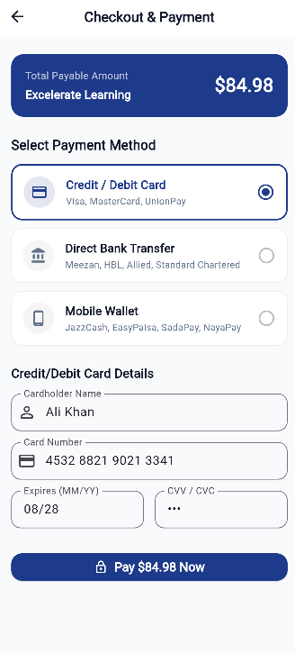 |
| *Live search & category filters* | *Dynamic course info & syllabus* | *Item removal & cost breakdown* | *Card, Bank & Mobile Wallets* |

---

### 🧑‍🏫 3. Teacher / Admin Flow: Authentication & Dashboard

| Teacher Login | Teacher Signup | Teacher Dashboard | Cart & Enrollment Pipeline |
|:---:|:---:|:---:|:---:|
| 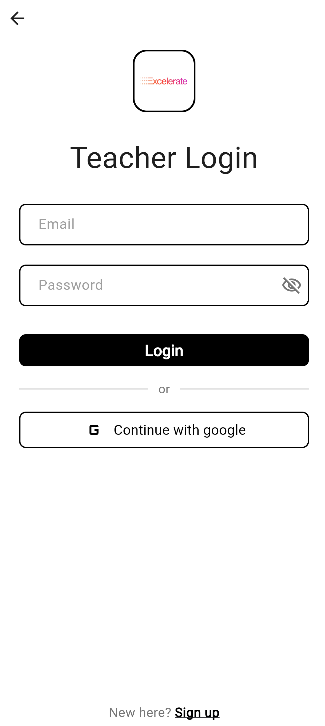 | 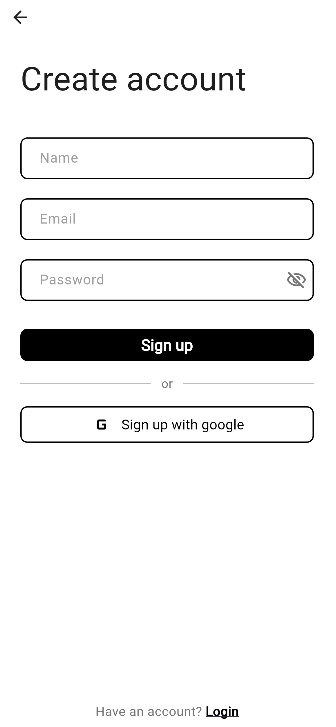 | 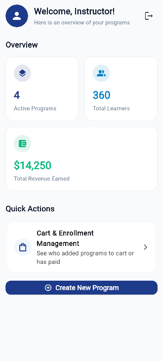 | 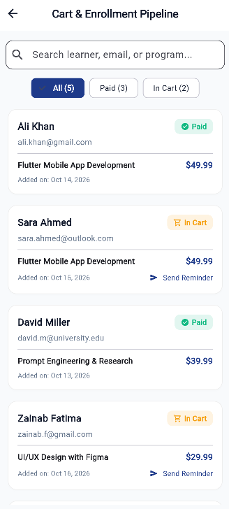 |
| *Teacher authentication wireframe* | *Instructor account creation* | *Programs, learners & revenue KPIs* | *Student pipeline & reminders* |

---

## 🌟 Week 2 Deliverables Summary

For Week 2, the core objective was translating Week 1 wireframes into an interactive, functional Flutter UI prototype. While Excelerate guidelines required at least **4 core screens**, Team 6 has completed **all 13 interactive screens**!

### Core 4 Mandatory Screens:
1. **Login Screen (`lib/screens/common/login_screen.dart`):** Multi-role authentication, email regex validation, password toggle, and navigation.
2. **Home Screen (`lib/screens/learner/home_screen.dart`):** Student greeting, active course progress card, live announcements, and bottom navigation.
3. **Programs Listing Screen (`lib/screens/learner/programs_list_screen.dart`):** JSON data loading (`assets/data/programs.json`), real-time search across titles and mentors, category filter chips (Mobile Dev, AI, UI/UX, Cloud), and bookmark toggles.
4. **Program Details Screen (`lib/screens/learner/program_details_screen.dart`):** Dynamically unpacks selected course arguments, displays syllabus, "What's Included" checklist, share link, bookmarks, and sticky "Add to Cart" button.

---

## 🚀 Week 3 Deliverables Summary (API / JSON Integration & Form Validation)

For Week 3, Team 6 evolved the UI prototype into a **functional, API-connected application** with live form validation, dynamic JSON data loading, and comprehensive test coverage. Full details are documented in [WEEK3_CHANGELOG.md](WEEK3_CHANGELOG.md).

### 🔑 Key Achievements:
1. **Dynamic JSON Data Loading:**
   - `ProgramsListScreen` dynamically loads catalog data asynchronously from `assets/data/programs.json` with a loading spinner and error retry mechanism (`FutureBuilder`).
   - `ProgramDetailsScreen` receives and unpacks dynamic `Program` arguments (title, mentor, pricing, ratings, what's included).
2. **Interactive Forms & Robust Validation:**
   - **Learner Login & Signup:** Strict email regex, password minimum 6-character length, confirm password matching, terms agreement checkbox, and loading spinners.
   - **Teacher Login & Signup:** Validation rules powered by `AuthValidators` with real-time SnackBar feedback.
   - **Checkout & Payment:** 16-digit card number validation, MM/YY expiration format check, CVV/CVC validation, and mobile wallet number regex.
3. **Cart & Reminder Management:**
   - Interactive cart management pipeline with status filtering (All, Paid, In Cart) and live payment reminders.
   - Dynamic cart pricing, discount calculations, and item deletion with an empty cart state.
4. **Automated Testing Suite:**
   - 100% test pass rate across 6 dedicated widget test suites (`auth_validation_test.dart`, `teacher_auth_test.dart`, `payment_validation_test.dart`, `cart_management_test.dart`, `learner_cart_test.dart`, `program_details_test.dart`).

---

## 📋 Complete 13-Screen Implementation Matrix

| # | Screen Name | Assigned Developer | File Path | Status |
|---|---|---|---|:---:|
| 1 | **Role Selection (Learner)** | Irtaza Ahmad (Lead) | `flutterdemo/lib/screens/common/role_selection_screen.dart` | ✅ Complete |
| 2 | **Learner Login** | Fatima Zahid | `flutterdemo/lib/screens/common/login_screen.dart` | ✅ Complete |
| 3 | **Learner Signup** | Fatima Zahid | `flutterdemo/lib/screens/common/signup_screen.dart` | ✅ Complete |
| 4 | **Learner Home Portal** | Irtaza Ahmad (Lead) | `flutterdemo/lib/screens/learner/home_screen.dart` | ✅ Complete |
| 5 | **Programs Listing** | Idiris Hassan | `flutterdemo/lib/screens/learner/programs_list_screen.dart` | ✅ Complete |
| 6 | **Program Details (Dynamic)** | Sameer Rizwan | `flutterdemo/lib/screens/learner/program_details_screen.dart` | ✅ Complete |
| 7 | **My Cart** | Mannu | `flutterdemo/lib/screens/learner/cart_screen.dart` | ✅ Complete |
| 8 | **Payment & Checkout** | Akshata | `flutterdemo/lib/screens/learner/payment_screen.dart` | ✅ Complete |
| 9 | **Role Selection (Teacher)** | Irtaza Ahmad (Lead) | `flutterdemo/lib/screens/common/role_selection_screen.dart` | ✅ Complete |
| 10 | **Teacher Login** | Aishika Pal | `flutterdemo/lib/screens/teacher/teacher_login_screen.dart` | ✅ Complete |
| 11 | **Teacher Signup** | Aishika Pal | `flutterdemo/lib/screens/teacher/teacher_signup_screen.dart` | ✅ Complete |
| 12 | **Teacher Dashboard** | Jennifer Shantal | `flutterdemo/lib/screens/teacher/teacher_dashboard_screen.dart` | ✅ Complete |
| 13 | **Cart Management (Admin)** | Abdul Kadir Choudhury | `flutterdemo/lib/screens/teacher/cart_management_screen.dart` | ✅ Complete |

---

## 🧭 Navigation Architecture

```
Welcome Screen (/)
      │
      ▼
Role Selection (/role_selection)
      │
      ├──────────────────────────────────────────────┐
      │ (Student Flow)                               │ (Teacher Flow)
      ▼                                              ▼
Learner Login / Signup                        Teacher Login / Signup
      │                                              │
      ▼                                              ▼
Learner Home Portal (/learner_home)           Teacher Dashboard (/teacher_dashboard)
      │                                              │
      ▼                                              ▼
Programs List (/programs_list)                Cart Management (/cart_management)
      │
      ▼
Program Details (/program_details)
      │
      ▼
My Cart (/cart)
      │
      ▼
Payment (/payment) ──► Confirmation Receipt ──► Back to Home
```

---

## 🛠️ Verification & Quality Assurance
- **Automated Tests:** `flutter test` passes 100% of widget tests.
- **Static Analysis:** `flutter analyze` passes with 0 compile errors.
- **Cross-Platform:** Responsive on Mobile (iPhone 14 / Android) and Web.

---

## 🚀 Running the Project Locally

```bash
# 1. Clone the repository
git clone https://github.com/irtazaad328/ED-TECH_App.git

# 2. Open project folder
cd ED-TECH_App/flutterdemo

# 3. Fetch Flutter packages
flutter pub get

# 4. Run on Chrome Web (Press F12 -> Ctrl+Shift+M for Mobile View)
flutter run -d chrome

# 5. Run on Connected Device / Android Emulator
flutter run
```

---

## 🤝 Team 6 Members
- **Irtaza Ahmad** (Team Lead)
- **Fatima Zahid**
- **Idiris Hassan**
- **Sameer Rizwan**
- **Mannu**
- **Akshata**
- **Aishika Pal**
- **Jennifer Shantal**
- **Abdul Kadir Choudhury**

---

## 🗺️ Project Roadmap
- [x] **Week 1:** Proposal, Figma wireframes, and project skeleton setup
- [x] **Week 2:** Build all 13 interactive Flutter UI screens, implement navigation flows, automated tests, and screenshots showcase
- [x] **Week 3:** Mock API / JSON integration, dynamic route arguments, robust form validations, loading states, and 100% test coverage
- [ ] **Week 4:** Final polish, comprehensive backend integration, and submission showcase
